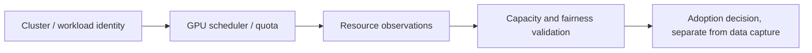

# Fork qualification notes — Kubernetes/GPU scheduling telemetry

**Scope:** public NVIDIA Run:ai source evaluation. **Status:** resource-control research; no on-prem GPU cluster deployment is asserted.

Scheduling, quotas, monitoring and training/inference workloads have separate privileges. A collected telemetry figure is **not** authority to provision compute, buy capacity or relocate private workloads. Compare recorded metrics with source version, node/driver/GPU identity and isolated workload fixtures. Do not extrapolate CPU-only host behavior to GPU orchestration.

Retain NVIDIA copyright, Apache-2.0 license, component-specific notice and trademark restrictions; this fork note does not authorize paid GPU use or production integration.
