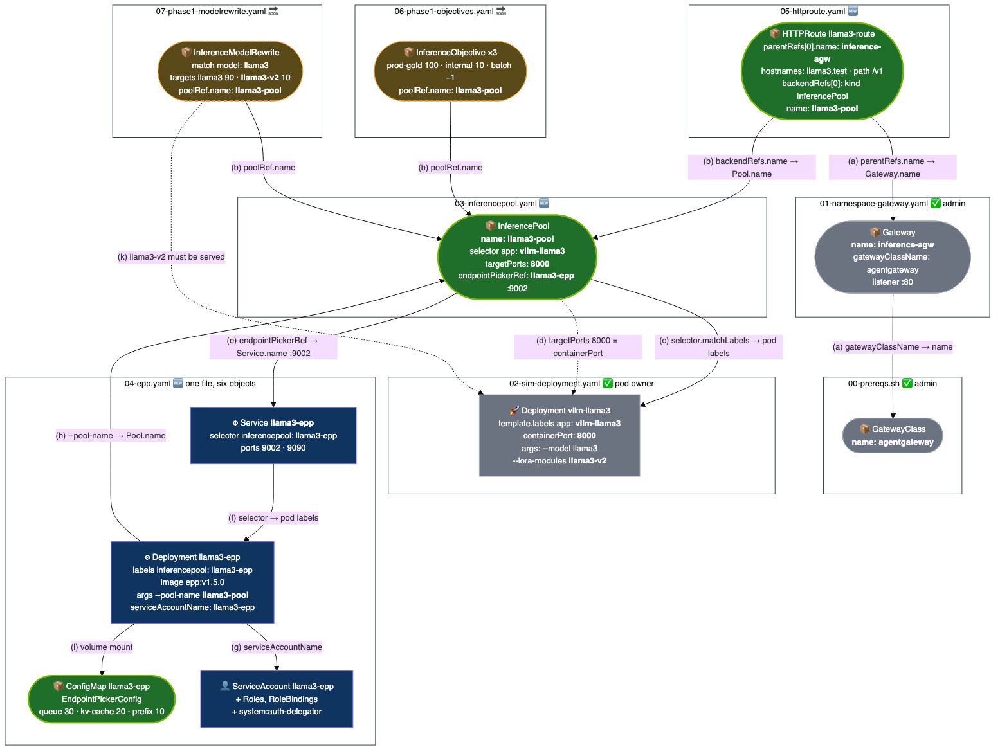

# Track A · the page's stack, by hand, no Dynamo, no controller code

Everything the `ModelEndpoint` controller would create, applied as static YAML. Markers: ✅ upstream / admin · 🆕 what the controller would create · 🔜 Phase 1, present but not enforced.

Plan and status log: [../../inference-networking-controller-lab-plan.md](../../inference-networking-controller-lab-plan.md).

## Files, in apply order

| # | File | Marker | What it is |
|---|---|---|---|
| 0 | `00-prereqs.sh` | ✅ | Gateway API v1.6.0 · GIE v1.5.0 CRDs · agentgateway v1.5.0 with inference extension |
| 1 | `01-namespace-gateway.yaml` | ✅ | `model-serving` namespace and the admin-owned `Gateway` `inference-agw` |
| 2 | `02-sim-deployment.yaml` | ✅ pod owner | 3 CPU simulators, label `app: vllm-llama3`, serve model `llama3` plus LoRA `llama3-v2` for the canary test |
| 3 | `03-inferencepool.yaml` | 🆕 | `InferencePool` `llama3-pool` → EPP `llama3-epp:9002` |
| 4 | `04-epp.yaml` | 🆕 | EPP ServiceAccount, Roles, ConfigMap (queue 30 / kv-cache 20 / prefix 10), Deployment `epp:v1.5.0`, Service |
| 5 | `05-httproute.yaml` | 🆕 | `HTTPRoute` `llama3-route`, host `llama3.test`, path `/v1`, backend = the pool |
| 6 | `06-phase1-objectives.yaml` | 🔜 | Gold 100 · Silver 10 · Batch −1 |
| 7 | `07-phase1-modelrewrite.yaml` | 🔜 | `llama3` → 90 % `llama3`, 10 % `llama3-v2` |
| 8 | `08-smoke-test.sh` | ✓ | The page's smoke-test guide as a script, checks 1 to 9 |
| 9 | `09-swap-epp-llmd.yaml` | 🔜 | Replaces the EPP image with llm-d Router v0.10.0, the "pluggable EPP" test |

## Run it

```bash
export KUBECONFIG=~/.kube/config.nasbi-run-42428   # or: kc add --cluster nasbi-run-42428 --session
cd docs/inference-networking-controller-lab/track-a
./00-prereqs.sh
kubectl apply -f 01-namespace-gateway.yaml
kubectl wait --for=condition=Programmed gateway/inference-agw -n model-serving --timeout=180s
kubectl apply -f 02-sim-deployment.yaml
kubectl apply -f 03-inferencepool.yaml -f 04-epp.yaml -f 05-httproute.yaml
kubectl wait --for=condition=available deploy/llama3-epp deploy/vllm-llama3 -n model-serving --timeout=180s
./08-smoke-test.sh
kubectl apply -f 06-phase1-objectives.yaml -f 07-phase1-modelrewrite.yaml
./08-smoke-test.sh phase1
```

## How the files connect



Source: [wiring.mmd](wiring.mmd). Re-render with `npx -y @mermaid-js/mermaid-cli@11 -i wiring.mmd -o wiring.png -b white -w 1800`.

Every link is one of three kinds: a **name reference**, a **label selector**, or a **volume mount**. Two names carry the stack, `inference-agw` and `llama3-pool`. The only link to the model pods is the label `app: vllm-llama3`.

| Link | From, file and field | To, file and field | Kind | If it breaks |
|---|---|---|---|---|
| (a) | `01` `Gateway.spec.gatewayClassName: agentgateway` | `00` GatewayClass from the helm chart | name ref | Gateway never Programmed |
| (a) | `05` `HTTPRoute.spec.parentRefs[0].name: inference-agw` | `01` `Gateway.metadata.name` | name ref | Route `Accepted=False` |
| (b) | `05` `HTTPRoute...backendRefs[0].name: llama3-pool` | `03` `InferencePool.metadata.name` | name ref | Route `ResolvedRefs=False` |
| (b) | `06` `InferenceObjective.spec.poolRef.name` | `03` `InferencePool.metadata.name` | name ref | objective silently ignored |
| (b) | `07` `InferenceModelRewrite.spec.poolRef.name` | `03` `InferencePool.metadata.name` | name ref | rewrite silently ignored |
| (c) | `03` `InferencePool.spec.selector.matchLabels.app` | `02` `Deployment.spec.template.metadata.labels.app` | label selector | pool has 0 endpoints, EPP returns 429 |
| (d) | `03` `InferencePool.spec.targetPorts[0].number: 8000` | `02` `containers[0].ports[0].containerPort` | port match | connection refused after pick |
| (e) | `03` `InferencePool.spec.endpointPickerRef.name: llama3-epp` + port 9002 | `04` `Service.metadata.name` + port | name ref | ext_proc fails, FailOpen falls back |
| (f) | `04` `Service.spec.selector.inferencepool` | `04` `Deployment.template.labels.inferencepool` | label selector | Service has no endpoints |
| (g) | `04` `Deployment.spec.serviceAccountName` | `04` `ServiceAccount.metadata.name` | name ref | EPP cannot list pods |
| (h) | `04` EPP arg `--pool-name llama3-pool` | `03` `InferencePool.metadata.name` | name in arg | EPP watches the wrong pool |
| (i) | `04` `Deployment.volumes[0].configMap.name` | `04` `ConfigMap.metadata.name` | mount | EPP fails to start |
| (j) | `04` `RoleBinding.subjects[0].name` | `04` `ServiceAccount` | name ref | RBAC denied |
| (k) | `07` `targets[].modelRewrite: llama3-v2` | `02` `--lora-modules '{"name":"llama3-v2"}'` | convention | sim returns 404 for unknown model |

## Names used everywhere

| Thing | Name |
|---|---|
| Namespace | `model-serving` |
| Gateway | `inference-agw`, class `agentgateway` |
| Pods label | `app: vllm-llama3` |
| InferencePool | `llama3-pool` |
| EPP | `llama3-epp`, gRPC 9002, metrics 9090 |
| HTTPRoute | `llama3-route`, hostname `llama3.test` |
| Model names the sim answers to | `llama3`, `llama3-v2` |

## What differs from the page, and why

| Page | Here | Why |
|---|---|---|
| agentgateway v1.0.1 from `ghcr.io/agentgateway/...` | v1.5.0 from `oci://cr.agentgateway.dev/charts/...` | Chart registry moved. v1.0.1 predates GIE v1.5 |
| Gateway API v1.3.0 + experimental | v1.6.0 standard only | agentgateway inference routing needs no experimental CRDs |
| EPP image unspecified | `registry.k8s.io/gateway-api-inference-extension/epp:v1.5.0` | Last GIE reference EPP tag. GIE v1.6 removed the EPP |
| EPP requests 4 CPU / 8 Gi (chart default) | 100m / 256 Mi | Kind cluster |
| Real vLLM on GPUs | `llm-d-inference-sim:v0.11.2` on CPU | Fake-GPU env |
