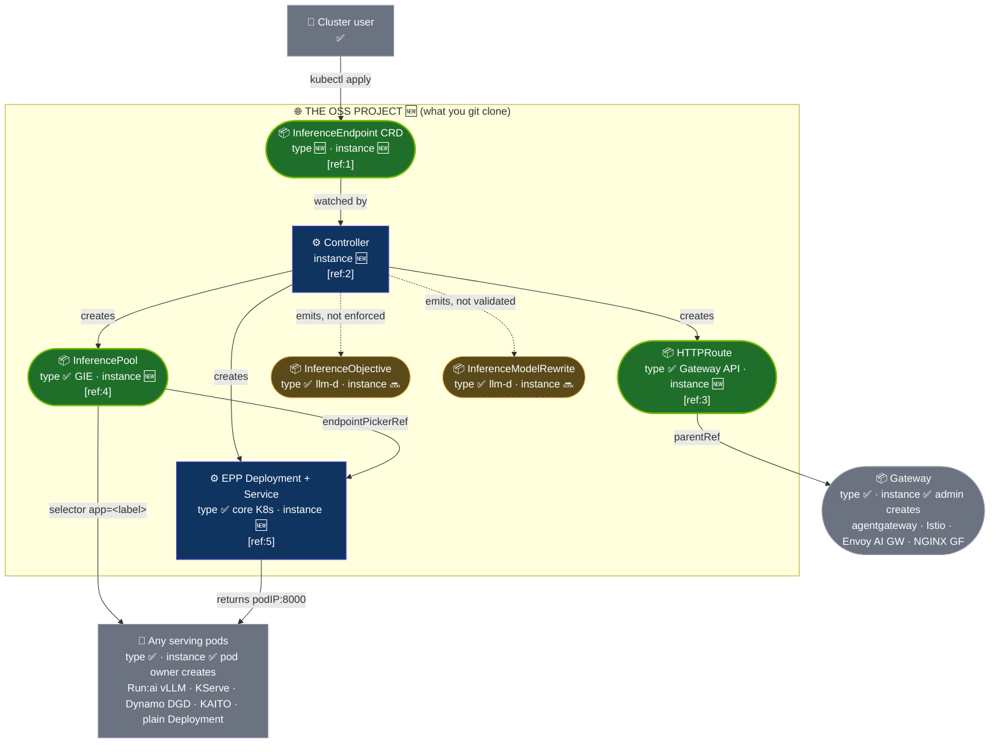

# Inference Networking Controller — read as a standalone open-source project

**Source material:** `architecture-inference-integration.html` (prototype pitch page) and
`inference-networking-controller-oss-landscape-report.md` (landscape report, 25 Aug 2026, RUN-42428 follow-on).
**Framing:** the controller is planned as a standalone OSS project. Run:ai is one pod owner among many.

**Markers used in every diagram:** ✅ EXISTS today · 🆕 NEW, contents of the OSS repo · 🔜 PLANNED, not built yet · 🎨 branding to strip

## TL;DR (the whole thing in 3 lines)

- The page describes a generic Kubernetes controller: one CR in, a Gateway API routing stack out, attached to *any* pods that carry a label.
- Everything Run:ai-specific on the page is cosmetic: the nav-bar name, the API group `inference.runai.com`, and the example pod owner. Swap those and nothing in the architecture changes.
- The OSS project delivers a CRD, a controller, and an EPP wiring convention. It depends on four upstream projects and owns none of them.

## What the HTML page contains, layer by layer

```
 LAYER 0 · WHO ASKS
   ┌──────────────────┐                     ┌──────────────────────────┐
   │ 👤 Developer  ✅ │                     │ 👤 Admin             ✅  │
   └────────┬─────────┘                     └────────────┬─────────────┘
            │ kubectl apply                              │ installs once, at setup time
            ▼                                            ▼
 LAYER 1 · THE PROJECT                       LAYER 1b · PREREQUISITE, NOT OURS
   ╭──────────────────────────╮              ╭──────────────────────────────╮
   │ 📦 ModelEndpoint     🆕  │              │ 📦 Gateway               ✅  │
   │   modelName, hostname,   │              │   class: agentgateway        │
   │   podSelector,           │              │   port 80                    │
   │   gateway.name ─────────────── references by name ──────►│           │
   │   tiers, epp.image       │              ╰──────────────▲───────────────╯
   ╰────────────┬─────────────╯                             │
                │ watched by                                │ parentRef
                ▼                                           │
   ┌──────────────────────────┐                             │
   │ ⚙ Controller         🆕  │                             │
   └──┬─────┬─────┬─────┬─────┘                             │
      │     │     │     │  creates                          │
      │     │     │     ╰──────────────────────╮            │
      │     │     ╰────────────╮               │            │
      │     ╰──────╮           │               │            │
      ▼            ▼           ▼               ▼            │
 LAYER 2 · WHAT THE CONTROLLER CREATES                      │
   ╭──────────╮ ╭──────────╮ ┌──────────────┐ ╭──────────────┴───╮
   │📦 Infer- │ │📦 Infer- │ │⚙ EPP         │ │📦 HTTPRoute  🆕  │
   │  ence    │ │  ence    │ │  Deployment  │ │  host llama3.*   │
   │  Pool 🆕 │ │  Objec-  │ │  + Service   │ │  path /v1/*      │
   │          │ │  tive +  │ │  + ConfigMap │ │  backend =       │
   │ selector │ │  Model-  │ │          🆕  │ │  InferencePool ──┼──► points at the Pool
   │ app=vllm-│ │  Rewrite │ │  scorers:    │ ╰──────────────────╯
   │ llama3   │ │      🔜  │ │  queue 30    │
   │          │ │          │ │  kvcache 20  │
   │ endpoint-│ │          │ │  prefix 10   │
   │ PickerRef┼─────────────►│  TLS :9002   │
   ╰────┬─────╯ ╰──────────╯ └──────┬───────┘
        │ selects by label           │ returns podIP:8000
        ▼                            ▼
 LAYER 3 · THE PODS, NOT OURS
   ┌────────────────────────────────────────────────────────┐
   │ 🚀 vLLM pods   label app: vllm-llama3              ✅  │
   │   on the page: scheduled by Run:ai                     │
   │   as OSS:      scheduled by any pod owner              │
   └────────────────────────────────────────────────────────┘

   NOT part of the stack, only a side section on the page:
   ┌────────────────────────────────────────────────────────┐
   │ NVIDIA Dynamo  ✅  "could replace the EPP box later,    │
   │   but it is not a simple image swap, needs its operator"│
   └────────────────────────────────────────────────────────┘
```

**Caption:** one CR, one controller, five created objects, two borrowed things, one pod set. Dynamo is a footnote.

### Pseudocode: how the page's stack comes to life

```
1. Admin installs Gateway API CRDs, GIE CRDs, agentgateway, and creates one Gateway.   ✅ once
2. Someone deploys vLLM pods with the label app: vllm-llama3.                          ✅ on the page it is Run:ai
3. Developer applies one ModelEndpoint that names the Gateway and the label.          🆕
4. Controller creates the InferencePool with that label as selector.                  🆕
5. Controller creates the EPP Deployment, Service, and ConfigMap with scorer weights.  🆕
6. Controller creates the HTTPRoute: attaches to the Gateway, backend is the Pool.     🆕
7. Controller also creates InferenceObjective and InferenceModelRewrite.               🔜 present, not enforced
8. A request arrives at the Gateway → HTTPRoute → Pool → asks EPP → EPP picks a pod.  ✓
9. Ask: did the pods get the right label?  → if no, the Pool sees zero endpoints.  ✗ EPP has nothing to pick
```

### The three kinds of relationship

| Relationship | Where it appears | What it means |
|---|---|---|
| **creates** | Controller → Pool, EPP, HTTPRoute, Objective, Rewrite | Controller owns it, deletes it with the CR |
| **references by name** | ModelEndpoint → Gateway. HTTPRoute → Gateway (parentRef). HTTPRoute → Pool (backendRef). Pool → EPP (endpointPickerRef) | Loose coupling. Only a name and a namespace |
| **selects by label** | Pool → pods | The only link to the model. No API call, just a label |

### Where Dynamo actually is on the page

| Question | Answer from the page |
|---|---|
| Is Dynamo part of the delivered stack? | **No.** The stack is agentgateway + GIE reference EPP |
| Where does Dynamo appear? | One "Ecosystem" section near the bottom, plus one bullet in "Pluggable EPP" |
| What does the page say about it? | It could replace the EPP box, but "it is not a simple image swap." It needs Dynamo's operator, and the ModelEndpoint alone is not enough |
| So who is the EPP on the page? | GIE reference EPP. The report says the product should use llm-d Router instead |

## The core system, OSS framing



**Caption:** the project defines exactly one CRD type. Everything else it creates is an instance of someone else's type.

### Where each type comes from

```
   WHO INSTALLS THE TYPE                        WHAT OUR CONTROLLER CREATES FROM IT
   (before we run, all ✅)                       (per ModelEndpoint, all 🆕)

   ╭───────────────────────────────╮
   │ 📦 our CRD               🆕   │  we ship it   ───►  ╭ ModelEndpoint ╮  the customer's intent
   │   inference.runai.com         │                     (renamed InferenceEndpoint by the report)
   ╰───────────────────────────────╯

   ╭───────────────────────────────╮
   │ 📦 Gateway API CRDs      ✅   │  admin,       ───►  ╭ HTTPRoute ╮      1. the routing rule
   │   gateway.networking.k8s.io   │  install step 1
   ╰───────────────────────────────╯

   ╭───────────────────────────────╮
   │ 📦 GIE CRDs              ✅   │  admin,       ───►  ╭ InferencePool ╮  2. the pod group + EPP pointer
   │   inference.networking.k8s.io │  install step 2
   ╰───────────────────────────────╯

   ┌───────────────────────────────┐
   │ ⚙ core Kubernetes        ✅   │  always there ───►  ┌ Deployment + Service + ConfigMap ┐
   │   apps/v1, v1                 │                                                            3. the EPP process
   └───────────────────────────────┘

   ╭───────────────────────────────╮
   │ 📦 llm-d CRDs            ✅   │  admin        ───►  ╭ InferenceObjective ╮      4. lanes      🔜
   │   llm-d.ai/v1alpha2           │  (page still        ╭ InferenceModelRewrite ╮   4. alias/canary 🔜
   │   page says: x-k8s.io/v1alpha2│   uses old group)
   ╰───────────────────────────────╯
```

**Caption:** one arrow per type. Left is who installs the schema, right is the object we stamp out of it.

### Purpose of each of the four, and its source

| # | Object we create | Purpose in one line | Type comes from | Existing CRD? |
|---|---|---|---|---|
| 1 | **HTTPRoute** | Attach to the admin's Gateway. Match `Host: llama3.<domain>` + `/v1/*`. Say "backend is the InferencePool, not a Service" | Gateway API, `kubernetes-sigs/gateway-api` v1.3.0 | ✅ yes, admin installs |
| 2 | **InferencePool** | Group the model pods by label `app: vllm-llama3`. Hold `endpointPickerRef` that tells the gateway which EPP to call | GIE, `gateway-api-inference-extension` v1.5.0 | ✅ yes, admin installs |
| 3 | **EPP Deployment + Service + ConfigMap** | Run the picker. Gateway calls it over gRPC before every request. ConfigMap holds scorer weights queue 30 / kvcache 20 / prefix 10 | Core Kubernetes `apps/v1`, `v1` | ❌ not a CRD. Image is GIE reference on the page, llm-d Router per the report |
| 4 | **InferenceObjective + InferenceModelRewrite** | Objective = priority lane per header value. Rewrite = alias `llama3` to full HF path, or 90/10 canary | llm-d Router, `llm-d.ai/v1alpha2`. Page still writes `inference.networking.x-k8s.io/v1alpha2`, which the report calls stale | ✅ yes, but from llm-d now, not GIE. 🔜 not enforced yet |

### Pseudocode: what a user of the OSS project does

```
1. Admin installs Gateway API CRDs, GIE CRDs, and a Gateway implementation.   ✅ prerequisites
2. Admin creates one Gateway resource.                                          ✅ prerequisite
3. User deploys model pods with any tool they like, and gives them a label.    ✅ user's choice
4. User installs the OSS controller.                                            🆕
5. User applies one InferenceEndpoint naming the Gateway and the label.        🆕
6. Controller creates HTTPRoute, InferencePool, EPP.                            🆕
7. Ask: is the Gateway there and does it support InferencePool?
   → if yes, traffic flows through the EPP.  ✓
   → if no, HTTPRoute is rejected, status should say why.  ✗ prototype does not report this yet
8. 🔜 Later: user adds lanes and canary rules on the same CR.
```

## Two ways to attach: we own the middle, or Dynamo does

The same request path, two ownership modes from the report. Left: the page's default. Right: a cluster where a
DynamoGraphDeployment already exists. Only the middle two boxes change owner.

```
        MODE  ManagedEPP  ·  page default                 MODE  ExistingPool  ·  Dynamo owns the middle

   ┌──────────────────────────┐                   ┌──────────────────────────┐
   │ 👤 Client            ✅  │                   │ 👤 Client            ✅  │
   └────────────┬─────────────┘                   └────────────┬─────────────┘
                │ POST /v1/chat, Host llama3.test              │ POST /v1/chat, header X-Gateway-Model-Name
                ▼                                              ▼
   ╭──────────────────────────╮                   ╭──────────────────────────╮
   │ 📦 Gateway agentgateway  │ ✅ admin           │ 📦 Gateway agentgateway  │ ✅ admin
   ╰────────────┬─────────────╯                   ╰────────────┬─────────────╯
                │ parentRef                                    │ parentRef
   ╭──────────────────────────╮                   ╭──────────────────────────╮
   │ 📦 HTTPRoute         🆕  │ we create          │ 📦 HTTPRoute         🆕  │ we create  ← the ONLY 🆕 here
   ╰────────────┬─────────────╯                   ╰────────────┬─────────────╯
                │ backendRef                                   │ backendRef
   ╭──────────────────────────╮                   ╭──────────────────────────╮
   │ 📦 InferencePool     🆕  │ we create          │ 📦 InferencePool     ✅  │ DGD operator creates
   │    llama3-pool           │                   │    <dgd>-pool            │
   ╰────────────┬─────────────╯                   ╰────────────┬─────────────╯
                │ endpointPickerRef :9002                      │ endpointPickerRef :9002
   ┌──────────────────────────┐                   ┌──────────────────────────┐
   │ ⚙ EPP                🆕  │ we create          │ ⚙ EPP                ✅  │ DGD operator creates
   │   GIE reference epp      │                   │   Dynamo EPP, Rust       │
   │   or llm-d Router        │                   │   in dynamo-frontend     │
   │   config: ConfigMap      │                   │   config: DYN_* env vars │
   └────────────┬─────────────┘                   └────────────┬─────────────┘
                │ picks podIP:8000                             │ picks worker
   ┌──────────────────────────┐                   ┌──────────────────────────┐
   │ 🚀 pods              ✅  │ any pod owner       │ 🚀 pods              ✅  │ DGD operator creates
   │   label app=vllm-llama3  │                   │   workers + Frontend     │
   └──────────────────────────┘                   │   sidecar                │
                                                  └──────────────────────────┘

   Objects we create:  3  (route, pool, EPP)        Objects we create:  1  (route)
```

**Caption:** in ManagedEPP the middle two boxes are ours. In ExistingPool they are Dynamo's. Same client, same Gateway, same pods concept.

### Pseudocode: how the controller should choose

```
1. Read the InferenceEndpoint.
2. Ask: is there already an InferencePool for these pods, owned by another controller?
   → if yes: ExistingPool. Create only the HTTPRoute pointing at that pool.  ✓
   → if no:  ManagedEPP. Create pool + EPP + HTTPRoute.  ✓
3. Never create a second pool or EPP around pods that another operator already owns.  ✗ two controllers fighting
4. Never swap Dynamo's EPP for ours by changing an image.  💥 Dynamo's EPP needs its operator and event plane
```

### Side by side

| | ManagedEPP, page default | ExistingPool, Dynamo |
|---|---|---|
| **What we create** | InferencePool, EPP, HTTPRoute, objectives, rewrite | HTTPRoute only |
| **Who owns pool + EPP** | us | Dynamo operator |
| **Who owns pods** | any pod owner: plain Deployment, Run:ai, KServe, KAITO | Dynamo operator, via DynamoGraphDeployment |
| **EPP** | GIE reference EPP or llm-d Router | Dynamo Rust EPP bundled in `dynamo-frontend` |
| **EPP config** | ConfigMap `EndpointPickerConfig` | `DYN_*` environment variables |
| **Version set** | Gateway API 1.6, GIE 1.5, agentgateway 1.5 | Dynamo pins Gateway API 1.5.1, GIE 1.2.1, agentgateway 1.0.0 |
| **Consequence** | | the two version sets cannot share one cluster today |
| **No-GPU option** | CPU `llm-d-inference-sim`, documented | `dynamo.mocker` on Dynamo Frontend documented; behind the Dynamo EPP undocumented |
| **What it proves** | the routing stack and the page's claims | the report's ownership-mode argument: we can be a neighbor, not an owner |

**🧠 Remember it as:** ManagedEPP we build the whole road. ExistingPool we only paint the exit sign onto Dynamo's road.

## What the page gets right and wrong for an OSS reader

| Topic | Page as written | OSS reading |
|---|---|---|
| **Who ships it** | Run:ai | Standalone repo, project-owned API group |
| **Who owns pods** | Run:ai scheduler | Anyone. Label is the only contract |
| **Gateway** | agentgateway, the "only" option | One of several. Report lists Istio, NGINX GF, Envoy AI GW, GKE |
| **EPP** | GIE reference by default, swap image | Versioned profiles, llm-d Router first |
| **Value claim** | "One CR creates the stack" | Already done by others. Value is neutrality + ownership modes |
| **Install guide** | Local `go run` | Would need Helm chart, image, RBAC, release process |
| **What is genuinely reusable** | The controller shape, the label seam, the honest footnotes | Same |

## The page, re-read section by section

```
   Page section                  What it really is for an OSS project
   ─────────────────────────     ──────────────────────────────────────────────
   "run:ai" logo, nav bar        🎨 branding only, drop it
   inference.runai.com/v1alpha1  🎨 API group, report says use a project-owned one
   "Run:ai Inference Workload"   ✅ one example pod owner, not a dependency
   "Run:ai Scheduler"            ✅ one example pod owner, not a dependency
   ModelEndpoint CR + Controller 🆕 THE PROJECT
   InferencePool / EPP / Route   🆕 objects the project creates, types are upstream
   agentgateway                  ✅ upstream dependency, one of several possible gateways
   GIE, Gateway API CRDs         ✅ upstream dependencies
   InferenceObjective / Rewrite  🔜 planned features, types now live in llm-d
   Dynamo section                ✅ ecosystem neighbor, potential ExistingPool owner
   Install + smoke test          🆕 the project's README, basically
```

**Caption:** three lines are the product. The rest is branding or upstream.

## Code references

| Ref | Location | Status |
|---|---|---|
| [ref:1] | `api/v1alpha1/modelendpoint_types.go` | Named in report. Source repo unknown, not in the Run:ai monorepo |
| [ref:2] | `internal/controller/modelendpoint_controller.go` | Named in report. Source repo unknown |
| [ref:3] | `internal/controller/httproute.go` | Named in report. Source repo unknown |
| [ref:4] | `inference.networking.k8s.io/v1` `InferencePool` | ✅ upstream GIE |
| [ref:5] | `internal/controller/epp.go` | Named in report. Source repo unknown |

## Legend

| Marker | Meaning |
|---|---|
| 🆕 NEW | Contents of the OSS repository |
| ✅ EXISTS | Upstream project or user-owned resource, prerequisite |
| 🔜 PLANNED | Phase 1, emitted but not enforced |
| 🎨 | Branding to strip before release |
| Outlined group | Repository boundary, what the OSS project contains |
| Pill-shaped node | CRD or custom-resource instance (InferenceEndpoint, HTTPRoute, InferencePool, Gateway, Objective, Rewrite) |
| Rectangle node | Running process or actor (controller, EPP, pods, user) |
| Green node | 🆕 instance created by this project |
| Purple node | Process shipped by this project |
| Grey node | ✅ exists, owned by admin, pod owner, or upstream |
| Orange dashed node | 🔜 planned, emitted but not enforced |
| Dashed arrow | Emitted, not enforced |
| 👤 / ⚙ / 📦 / 🚀 | Caller / service / custom resource / pods |

## What we proved live, 2026-09-06

Env `nasbi-run-42428` (Kind, fake GPUs, CPU simulators). The controller's five outputs applied by hand. Details and status log in [inference-networking-controller-lab-plan.md](inference-networking-controller-lab-plan.md).

| Page claim | Live result |
|---|---|
| Smart routing beats round-robin | ✅ EPP spread a 30-request burst 11 / 7 / 4 by queue depth |
| HTTPRoute → InferencePool, agentgateway resolves it natively | ✅ `Accepted=True ResolvedRefs=True`, e2e completion |
| EPP over TLS, agentgateway skip-verify | ✅ `secure-serving: true`, no ext_proc errors |
| Lanes via `x-gateway-inference-objective` | ✅ tracked (`priority=-1` logged), ❌ not enforced, exactly as the page admits |
| Canary via InferenceModelRewrite | ✅ 4 of 20 requests rewritten to the canary model |
| Pluggable EPP by image swap | ✅ for GIE v1.5.0 → llm-d Router v0.10.0, objectives still honored |
| "Only agentgateway supports InferencePool" | not tested, report says false |
| One CR creates the stack | not tested, controller source unavailable |

| Report finding | Live result |
|---|---|
| `/v1`-only routes collide on one Gateway | ✅ reproduced: two hostless routes both Accepted, older wins silently |
| `x-k8s.io` objective group is stale | ⚠️ true for the future, **not yet breaking**: llm-d v0.10.0 still reads it |
| Prototype has no RBAC for metrics auth | ✅ EPP metrics 401/500 until `system:auth-delegator` was bound |

Second env `nasbi-run-42428-dyn`, Dynamo operator 1.0.1 shipped by the wizard, CPU mocker workers.

| Dynamo question | Live result |
|---|---|
| Dynamo runs without GPUs | ✅ `dynamo.mocker` worker + Frontend answered a chat completion, KV events on NATS |
| Dynamo pods as a plain pod owner under our stack, ManagedEPP | ✅ our InferencePool selected the Dynamo Frontend pods by label, our GIE EPP picked one, completion returned through agentgateway |
| Dynamo owns pool + EPP, we own only the route, ExistingPool | ⛔ not tested: Dynamo's EPP image is gated on NGC, no pull secret in the env |
| Version skew | ⚠️ Dynamo pins Gateway API 1.5.1, GIE 1.2.1, agentgateway 1.0.0. Track A ran 1.6.0 / 1.5.0 / 1.5.0. Separate clusters were required |


## 🔧 If you only do one thing

Find the two arrows leaving the outlined group: Gateway name and pod label. If the project keeps those as its only contracts, it stays neutral. If it grows a third, it starts becoming a serving operator.

## 🧠 Remember it as

The page is a Run:ai demo of a project that does not need Run:ai.

## Fuller sources

- Landscape report: `~/dev/z_other/inference-networking-controller-oss-landscape-report.md`, sections 9 (contract), 12 (prototype gaps), 15 (delivery plan).
- Prototype page: `~/Downloads/architecture-inference-integration.html`.
- Hands-on lab plan, two tracks: [inference-networking-controller-lab-plan.md](inference-networking-controller-lab-plan.md).
